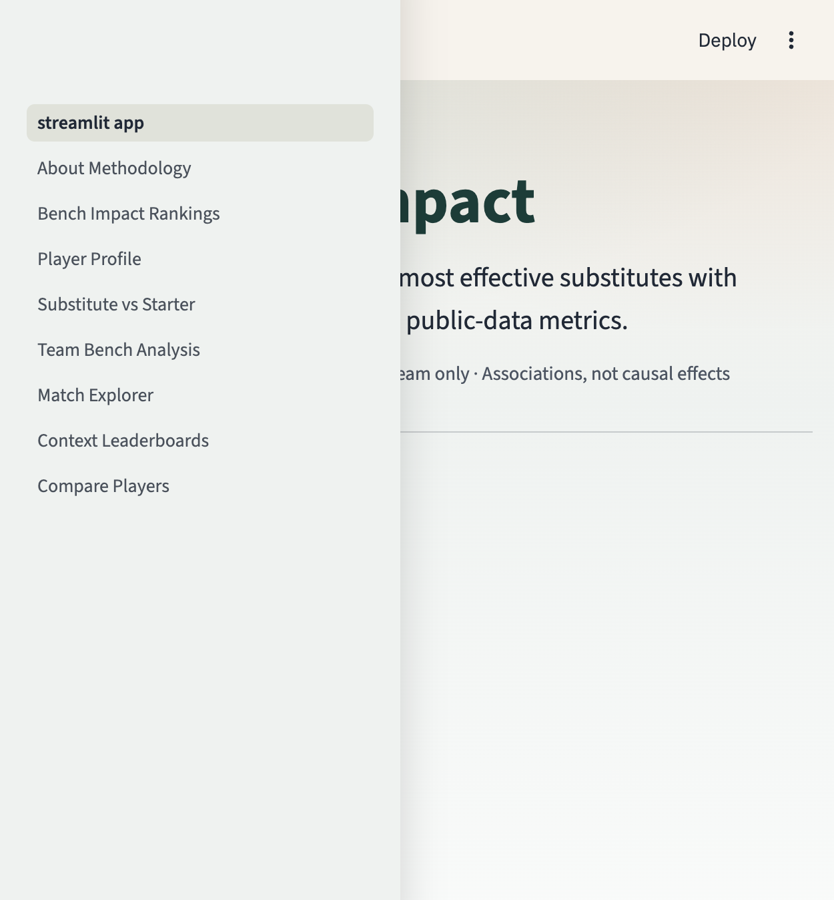
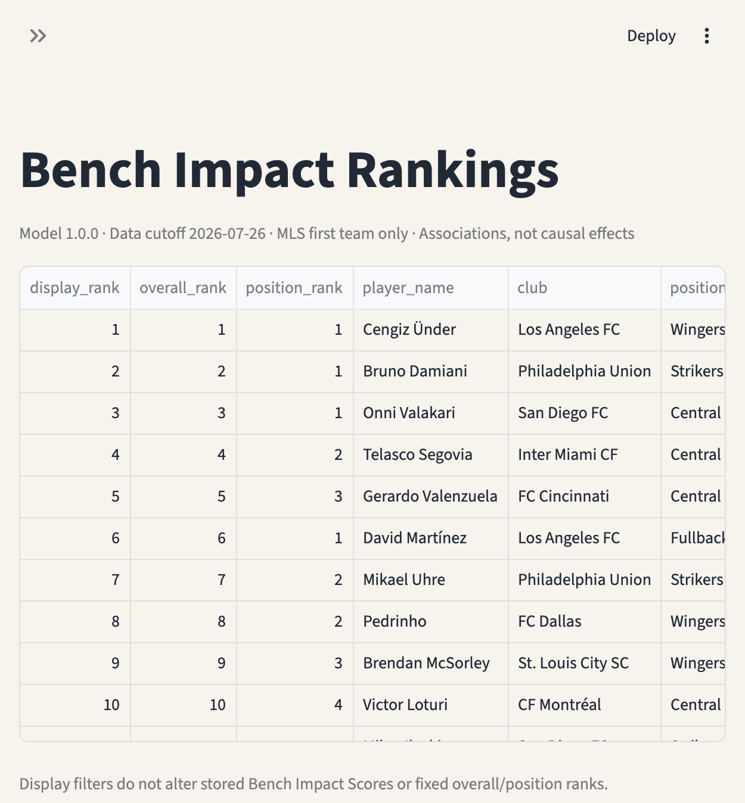

# MLS Bench Impact

## Identifying Major League Soccer’s Most Effective Substitutes

Production analytics project that estimates **measurable substitute contribution** for MLS outfield players in the **2025 season** and **2026 season-to-date**, with context adjustment, sample-size shrinkage, validation, exports, and a full application.

> Which MLS players provide the greatest measurable impact when entering matches as substitutes, after accounting for playing time, position, entry minute, score state, opponent strength, team strength, and substitution context?

> Which players perform meaningfully better as substitutes than they do as starters?

**These are associations from public data — not causal claims that a substitution caused team improvement.**

---

## Why it matters

Substitute minutes are sparse, confounded, and usually ranked by goals/assists alone. MLS Bench Impact separates:

1. Strong players who happen to receive bench minutes  
2. Players who consistently perform well in substitute appearances  
3. Players whose teams improve after they enter (association)  
4. Players especially effective relative to their own starting role  
5. Interesting but under-evidenced results (watchlist)

---

## Screenshots





Local app: `http://localhost:8501` after `make app` or `./scripts/run_production.sh`.

Repository: https://github.com/shirinalapati/mls-bench-impact  

Cloud deploy: connect that repo on [Streamlit Community Cloud](https://share.streamlit.io) with entrypoint `streamlit_app.py` (packaged DB at `data/release/mls_bench_impact.db`).  

---

## Data sources

| Source | Use |
| --- | --- |
| [American Soccer Analysis API](https://app.americansocceranalysis.com/) | Game-level Goals Added, xG/xA, teams, players, games |
| FotMob MLS match pages | Lineups, substitutions, score/card events, shotmap xG |

Audits: `DATA_FEASIBILITY_AUDIT.md`, `DATA_SOURCE_AUDIT.md`, `EVENT_SCHEMA_AUDIT.md`, `SUBSTITUTION_DATA_AUDIT.md`.

---

## Method (short)

1. Build on-field intervals from FotMob lineups + substitutions (stoppage-aware).  
2. **Substitute Sporting Impact** — shrunk ASA G+/96 → position percentile.  
3. **Adjusted Team Impact After Entry** — ridge-adjusted post-entry team xG differential association.  
4. **Positive Impact Frequency** — beta-binomial adjusted positive residual rate.  
5. **Substitute Advantage** — sub vs starter stabilized rate difference.  
6. **Bench Impact Score** — `0.50·SSI + 0.30·ATI + 0.20·PIF%` (configured weights).

Details: `docs/methodology.md`.

---

## Application pages

1. About & Methodology  
2. Bench Impact Rankings  
3. Player Profile  
4. Substitute vs Starter  
5. Team Bench Analysis  
6. Match Explorer  
7. Context Leaderboards  
8. Compare Players  

---

## Installation

```bash
python3 -m pip install -r requirements.txt
python3 -m pip install -e .
export PYTHONPATH=src
```

## Pipeline execution

One command:

```bash
chmod +x scripts/run_production.sh
./scripts/run_production.sh
```

This restores dependencies, initializes SQLite, ingests ASA + FotMob, builds intervals/appearances, fits models, scores players, validates, exports, tests, and starts the app.

Stepwise:

```bash
make install
make pipeline   # ingest + validate + exports
make test
make app
```

## Deployment

See `docs/deployment.md`. Primary app entrypoint:

```bash
streamlit run src/mls_bench_impact/app/streamlit_app.py
```

## Project layout

```
src/mls_bench_impact/   # package: ingest, transform, models, scoring, app, exports
data/raw/               # cached ASA/FotMob pulls
data/processed/         # SQLite warehouse
data/exports/           # Excel/CSV/PDF
reports/                # validation HTML
docs/                   # methodology & deployment
tests/                  # unit + data-quality tests
```

## Limitations

- ASA Goals Added is game-level for minutes played (not possession-timed after entry).  
- Simultaneous substitutions increase Model Uncertainty.  
- Identity bridging can miss rare name variants.  
- Full list: `docs/limitations.md`.

## License / attribution

Analytics built on publicly accessible ASA API responses and FotMob page data for research/portfolio use. Respect source terms and rate limits.
